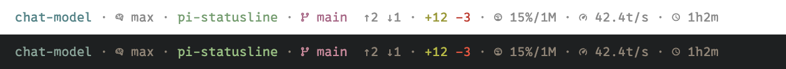

# pi-statusline

[](https://www.npmjs.com/package/@hariketsu/pi-statusline)
[](https://www.npmjs.com/package/@hariketsu/pi-statusline)
[](./LICENSE)
[](https://pi.dev/packages/@hariketsu/pi-statusline)

One line under the editor with the few facts you actually look at while working:
which model is answering, where you are, what changed, how much context is left, and
how fast the tokens are coming.



## Install

```sh
pi install npm:@hariketsu/pi-statusline
```

Start a new session or run `/reload`. To track the repository instead:

```sh
pi install git:github.com/Hariketsu/pi-statusline
```

`/statusline` switches back to pi's built-in footer; `/statusline debug` prints the raw
numbers behind each segment when something looks off.

## What it shows

| | |
|---|---|
| **Model and thinking level** | `chat-model · 󰧑 max` |
| **Where you are** | directory, branch, `↑2 ↓1` against upstream, `+12 −3` working-tree lines |
| **How much room is left** | `󰡳 15%/1M`; the gauge steps at 20/50/85%, the color at 70/90% |
| **How fast it is going** | `󰓅 42.4t/s` for the last turn, measured from the stream |
| **How long you have been here** | `󰅐 1h2m` |
| **What other extensions need** | their `ctx.ui.setStatus()` text, appended as-is |

Anything without data stays hidden — no `--` placeholders. The prompt cache only speaks up
when it stops working (below 50% hit rate).

Colors come from the terminal: the light and dark Gruvbox palettes are picked from what the
terminal reports, so the line reads well either way.

## Requirements

- [pi](https://pi.dev) 1.5 or newer, in interactive mode (the footer is a TUI component)
- Node.js 22.19+
- A Nerd Font for the icons; set `"icons": "emoji"` or `"none"` to use something else

## Make it yours

Settings live in `~/.pi/agent/settings.json` next to the rest of your pi configuration:

```json
{
  "statusline": {
    "segments": ["model", "dir", "git", "diff", "context", "tps", "duration"],
    "separator": " · ",
    "icons": "nerd"
  }
}
```

Every segment is optional and reorderable; `style` switches between colored text and
background blocks. The full list of keys is in
[docs/configuration.md](./docs/configuration.md).

## Privacy

It reads pi's session state and asks `git` for line counts. No network calls, no
telemetry, no files written outside the settings you already have.

## Documentation

- [Configuration](./docs/configuration.md) — every setting, every segment
- [How it works](./docs/internals.md) — what it reads from pi, how each number is measured
- [Development](./docs/development.md) — tests, adding a segment, the preview script
- [Publishing](./docs/publishing.md) — npm scope, gallery, release checklist

## License

MIT
