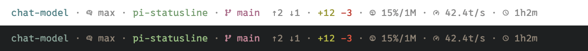

# pi-statusline

[English](./README.md) | 中文

[](https://www.npmjs.com/package/@hariketsu/pi-statusline)
[](https://www.npmjs.com/package/@hariketsu/pi-statusline)
[](./LICENSE)
[](https://pi.dev/packages/@hariketsu/pi-statusline)

编辑器下方的一行状态栏，只放你干活时真的会看的东西：谁在答、你在哪、改了多少行、上下文还剩多少、出字有多快。



## 安装

```sh
pi install npm:@hariketsu/pi-statusline
```

新开会话或 `/reload` 生效。想跟踪仓库而不是发布版：

```sh
pi install git:github.com/Hariketsu/pi-statusline
```

`/statusline` 切回 pi 原生 footer；`/statusline debug` 打印每段的原始数值，用来排查「某段怎么不见了」。

## 显示什么

| | |
|---|---|
| **模型与思考等级** | `chat-model · 󰧑 max` |
| **你在哪** | 目录、分支、对上流的 `↑2 ↓1`、工作区 `+12 −3` |
| **还剩多少空间** | `󰡳 15%/1M`；仪表图标在 20/50/85% 换字形，颜色在 70/90% 升级 |
| **出字速度** | `󰓅 42.4t/s`，最近一轮的实测值 |
| **待了多久** | `󰅐 1h2m` |
| **其它扩展的状态** | 原样接在行尾（它们的 `ctx.ui.setStatus()`） |

没有数据的段直接不出现，不会显示 `--` 之类的占位；prompt 缓存平时沉默，只有命中率掉到 50% 以下才提醒。

颜色跟着终端走：按终端上报的明暗自动选 Gruvbox Light / Dark。

## 要求

- [pi](https://pi.dev) 1.5 以上，且是交互模式（footer 是 TUI 组件）
- Node.js 22.19+
- 图标需要 Nerd Font；没有就设 `"icons": "emoji"` 或 `"none"`

## 调成你的样子

配置写在 `~/.pi/agent/settings.json`，和 pi 其它配置放一起：

```json
{
  "statusline": {
    "segments": ["model", "dir", "git", "diff", "context", "tps", "duration"],
    "separator": " · ",
    "icons": "nerd"
  }
}
```

每段都可以删、可以调顺序；`style` 可以在彩色文字与背景色块之间切换。完整键位见 [docs/configuration.md](./docs/configuration.md)。

## 隐私

只读 pi 的会话状态，并向 `git` 询问行数。没有网络请求、没有遥测、不写你配置之外的文件。

## 文档

- [配置](./docs/configuration.md) — 每个设置项、每个段
- [工作原理](./docs/internals.md) — 从哪里取数、每个数字怎么算出来的
- [开发](./docs/development.md) — 测试、加一段、预览图脚本
- [发布](./docs/publishing.md) — npm scope、插件画廊、发布前检查

## License

MIT
